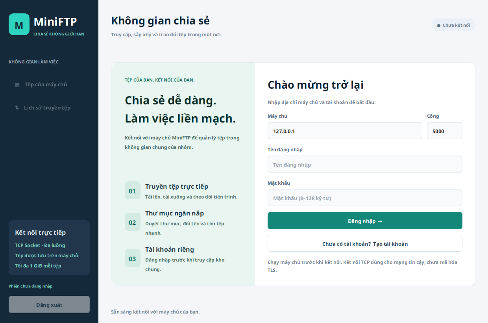
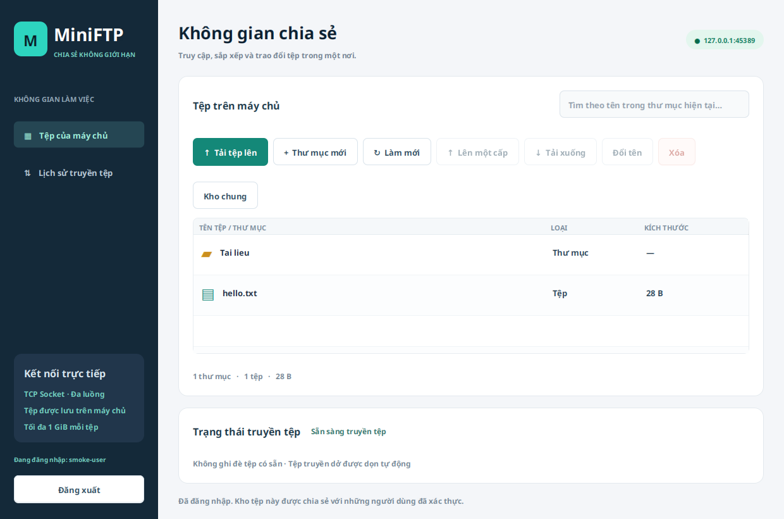

# MiniFTP — JavaFX · TCP Socket · Đa luồng

Đồ án môn **Lập trình mạng**. Ứng dụng chia sẻ tệp giữa một máy chủ và nhiều client, xây dựng bằng Java 21 và JavaFX 21. Giao diện client quản lý kho tệp chung; giao diện server cấu hình nơi lưu trữ, bật/tắt dịch vụ và xem nhật ký thực tế.

Dự án dùng **giao thức TCP riêng**, không phải FTP theo RFC 959 và không kết nối bằng FileZilla/FTP client thông thường. Client và server cần chạy cùng phiên bản mã nguồn.

## Giao diện

Ảnh chụp từ kiểm thử JavaFX thật; tệp hiển thị là dữ liệu thử tạm.





## Chức năng

- Đăng ký, đăng nhập; lưu tài khoản bằng PBKDF2-HMAC-SHA256 có salt riêng, không có tài khoản/mật khẩu mặc định.
- Tải lên và tải xuống tệp nhị phân, hiển thị tiến trình và lịch sử tối đa 100 tác vụ của phiên đăng nhập.
- Duyệt thư mục lồng nhau bằng nhấp đúp, thanh đường dẫn hoặc nút lên một cấp; lọc tên trong thư mục hiện tại, sắp xếp danh sách.
- Tạo thư mục, đổi tên tệp/thư mục, xóa tệp hoặc thư mục rỗng với bước xác nhận.
- Nhiều client thao tác đồng thời; tác vụ mạng chạy nền để giao diện tiếp tục phản hồi.
- Server kiểm tra quyền đăng nhập và đường dẫn, chặn đường dẫn vượt kho lưu trữ và liên kết tượng trưng; dọn tệp tạm khi truyền thất bại.
- Server dashboard có chọn kho, cổng, địa chỉ mạng, bộ đếm upload/download theo nhật ký và vùng nhật ký có giới hạn.

**Quyền chia sẻ:** mọi tài khoản đã đăng nhập đều có quyền đọc, ghi, đổi tên và xóa trong cùng một kho chung. Hiện chưa có vai trò quản trị hoặc thư mục riêng từng người dùng. Lịch sử truyền chỉ tồn tại trong phiên client, không phải lịch sử kiểm toán lưu trên server.

## Yêu cầu

- **JDK 21 trở lên**, gồm cả `java` và `javac`; đặt `JAVA_HOME` đến thư mục JDK nếu cần.
- Maven Wrapper đã đi kèm (`mvnw`, `mvnw.cmd`), không bắt buộc cài Maven riêng. Lần build đầu cần Internet để tải Maven, JavaFX và dependency từ Maven Central.
- Giao diện cần màn hình desktop. Trên Linux cần thư viện GTK 3, X11 và font chữ (ví dụ Debian/Ubuntu: `libgtk-3-0`, tên gói có thể là `libgtk-3-0t64` tùy phiên bản). Server console không cần màn hình.
- Linux/macOS cần `unzip` để wrapper dùng gói Maven ZIP đã gắn checksum; không bỏ kiểm tra checksum nếu công cụ giải nén còn thiếu.

Kiểm tra JDK:

```sh
java -version
javac -version
```

Các lệnh dưới đây chạy **tại thư mục chứa `pom.xml`**.

## Chạy ứng dụng

Mở terminal thứ nhất để chạy giao diện server:

```sh
./mvnw -Djavafx.mainClass=com.miniftp.app.ServerMain javafx:run
```

Mở terminal thứ hai để chạy client:

```sh
./mvnw javafx:run
```

Trên Windows PowerShell dùng:

```powershell
.\mvnw.cmd -Djavafx.mainClass=com.miniftp.app.ServerMain javafx:run
.\mvnw.cmd javafx:run
```

Nếu hệ điều hành chưa cho phép chạy wrapper, dùng `chmod +x mvnw` trên Linux/macOS hoặc chạy `sh mvnw …`.

### Phiên chia sẻ đầu tiên

1. Trên **server**, chọn thư mục lưu trữ hoặc giữ `server_storage`, chọn cổng mặc định `5000`, rồi bấm **Khởi động máy chủ**. Đợi trạng thái đang chạy.
2. Trên **client**, nhập `127.0.0.1` nếu chạy cùng máy, hoặc IP LAN của máy server nếu chạy khác máy. Nhập cùng cổng server.
3. Chọn **Tạo tài khoản**, nhập tên và mật khẩu, xác nhận mật khẩu rồi gửi. Đăng ký thành công sẽ đăng nhập và mở kho chung.
4. Tên đăng nhập phân biệt hoa/thường, có **3–32 ký tự**, gồm chữ Latin, số, `_`, `.` hoặc `-`; bắt đầu bằng chữ hoặc số. Mật khẩu có **8–128 ký tự**.
5. Dùng **Tải tệp lên**, chọn một tệp; nhấp đúp thư mục để đi vào. Chọn một tệp rồi **Tải xuống** và chọn thư mục đích trên máy client.
6. Dùng **Thư mục mới**, **Đổi tên**, **Xóa** hoặc **Làm mới** (`F5`) khi cần. Ô tìm kiếm chỉ lọc danh sách của thư mục đang mở.
7. Xem **Lịch sử truyền tệp** ở thanh bên. Đăng xuất sẽ xóa lịch sử phiên trên giao diện.

Khi dùng hai máy, cho phép cổng TCP đã chọn qua tường lửa của server và bảo đảm hai máy có thể kết nối trong mạng LAN. Địa chỉ `127.0.0.1` luôn chỉ chính máy client; không dùng nó để truy cập server ở máy khác.

### Server không có giao diện

Build JAR như phần tiếp theo rồi chạy:

```sh
java -cp target/MiniFTP-1.0.0-app.jar com.miniftp.app.ServerConsoleMain 5000 server_storage
```

Hai tham số lần lượt là cổng TCP và thư mục kho; có thể bỏ để dùng mặc định. Nếu đường dẫn có dấu cách, đặt trong dấu ngoặc kép. Dừng bằng `Ctrl+C`.

## Build và đóng gói

```sh
./mvnw clean package
```

JAR có dependency được tạo tại `target/MiniFTP-1.0.0-app.jar`:

```sh
# Client
java -jar target/MiniFTP-1.0.0-app.jar

# Server dashboard
java -cp target/MiniFTP-1.0.0-app.jar com.miniftp.app.ServerMain
```

JavaFX chứa thư viện native theo **hệ điều hành và kiến trúc máy build**. Hãy build trên nền tảng đích; JAR build trên Linux không phải bản phân phối dùng chung cho Windows/macOS. Máy chạy vẫn cần Java 21+ và các thư viện desktop của hệ điều hành. Chưa có bộ cài native hoặc bản runtime Java đi kèm.

## Kiểm thử

```sh
./mvnw test
# Windows
.\mvnw.cmd test
```

Bộ kiểm thử tự tạo kho tạm và dùng socket thật với cổng tự cấp; không dùng `server_storage` của bạn:

- `AuthenticationDirectoryTest`: yêu cầu xác thực, đăng ký, mật khẩu sai, tài khoản sau khi khởi động lại, thư mục lồng nhau, đổi tên, truyền đồng thời và chặn đường dẫn/liên kết tượng trưng.
- `FileManagerSafetyTest`: tên/đường dẫn, không ghi đè, tệp tạm và đổi tên thư mục khi còn upload.
- `LegacyRegressionTest`: chạy bộ hồi quy gốc qua `MiniFtpIntegrationTest`, gồm upload dở, nhiều client upload cùng tên và server đóng kết nối khi file download bị rút ngắn.

Kiểm tra giao diện bổ sung cần desktop hoặc Xvfb, không bật mặc định trong bài kiểm tra headless:

```sh
./mvnw -Dtest=JavaFxSmokeTest -Dminiftp.uiSmoke=true test
# Linux có Xvfb
xvfb-run -a ./mvnw -Dtest=JavaFxSmokeTest -Dminiftp.uiSmoke=true test
```

Kết quả chạy thực tế nằm trong `target/surefire-reports/`. Bài kiểm tra phụ thuộc khả năng hệ điều hành có thể được bỏ qua khi nền tảng không hỗ trợ; xem báo cáo để phân biệt số bài chạy và số bài bỏ qua. Không suy ra đã kiểm thử Windows/macOS từ một lần build Linux.

## Dữ liệu và giới hạn hiện tại

- Mỗi tệp truyền tối đa **1 GiB**. Không ghi đè tệp đã có, cả ở kho server lẫn thư mục tải xuống; hãy đổi tên hoặc chọn vị trí khác.
- Không xóa đệ quy thư mục có dữ liệu. Tên bắt đầu bằng dấu chấm, ký tự điều khiển, ký tự cấm của Windows và tên thiết bị như `CON` không được chấp nhận.
- Tài khoản được lưu trong tệp ẩn **`.accounts.properties` bên trong kho server**. Tệp chứa salt/hash, không chứa mật khẩu thuần và không được truy cập qua API tệp. Sao lưu cả kho cùng tệp này khi muốn giữ tài khoản. Chuyển sang kho khác sẽ dùng tập tài khoản của kho đó.
- Mỗi thao tác client mở một kết nối ngắn và đăng nhập trước khi gửi lệnh. Trạng thái đã đăng nhập trên giao diện không phải một socket luôn mở; server mất kết nối sẽ được báo ở thao tác tiếp theo.
- Giao thức hiện **chưa mã hóa TLS**: mật khẩu và dữ liệu đi qua TCP không mã hóa. Chỉ dùng trong mạng tin cậy/LAN cho bài tập; không mở dịch vụ trực tiếp ra Internet. Chưa có chức năng tiếp tục truyền dở, phân quyền theo vai trò hay đặt lại mật khẩu.
- Chỉ chạy một tiến trình server trên một kho; kho và tệp tài khoản được thiết kế cho một server quản lý.

## Cấu trúc mã nguồn

```text
src/main/java/com/miniftp/
  app/       ClientMain, ServerMain, ServerConsoleMain
  client/    FTPClient, callback tiến trình truyền
  common/    Giao thức và mô hình FileInfo
  server/    Vòng accept socket, nhóm worker, xử lý lệnh
  services/  FileManager và AuthManager
  ui/        ClientGUI, ServerGUI bằng JavaFX
src/main/resources/com/miniftp/ui/theme.css
src/test/java/com/miniftp/
docs/PROTOCOL.md
```

UI gọi `FTPClient` trong tác vụ nền; server xử lý TCP bằng nhóm 16 worker và hàng đợi giới hạn. `FileManager` chịu trách nhiệm thao tác trong kho, `AuthManager` lưu và kiểm tra tài khoản. Chi tiết định dạng lệnh nằm trong [docs/PROTOCOL.md](docs/PROTOCOL.md).

## Xử lý lỗi thường gặp

| Triệu chứng | Kiểm tra |
| --- | --- |
| Không có `javac` hoặc lỗi compiler | Cài JDK, không chỉ JRE; kiểm tra `JAVA_HOME` và phiên bản Java đang dùng. |
| Client không kết nối được | Server đã bật, IP/cổng đúng, tường lửa cho phép; IP máy khác không phải `127.0.0.1`. |
| Server báo cổng đang được dùng | Dừng tiến trình chiếm cổng hoặc chọn cổng khác, rồi nhập cùng cổng trên client. |
| Tài khoản không đúng sau khi đổi kho | Mỗi kho có tệp tài khoản riêng; kiểm tra đúng kho server hoặc đăng ký tài khoản tại kho mới. |
| JavaFX báo không mở được display | Chạy giao diện trong desktop/Xvfb; dùng `ServerConsoleMain` nếu chỉ cần dịch vụ headless. |
| Tệp/thư mục đã tồn tại | Đổi tên hoặc chọn thư mục khác; ứng dụng không tự ghi đè. |
| Maven không tải được dependency | Kiểm tra mạng/proxy Maven và chứng chỉ của tổ chức; giữ xác minh TLS và checksum. |
